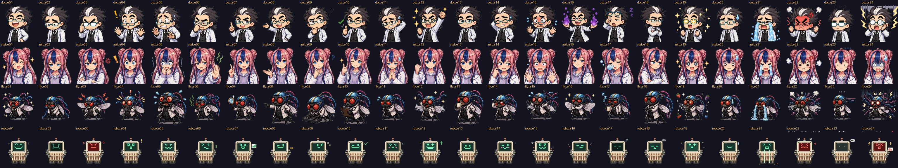

# ahnboat_lab_explainer — 연구실 해설 대시보드 스킬과 팩

논문이나 교과서 한 장을 받아, **박사 · 조수 하루 · 초파리 연구원 · 주판봇** 네 캐릭터가 진행하는 단일 HTML 교육 페이지로 만드는 AI 스킬과 그 팩 모음이다. 인공지능·통계학·경제학·회계학·경영학을 다루고, 외국어판 제작, 완성된 페이지의 온톨로지 보강, 다관점 검수까지 한 저장소에서 관리한다.

글 · 안상선 ((주)M-Robo 대표)



---

## 하려는 일 → 필요한 파일

| 하려는 일 | 함께 줄 파일 |
|---|---|
| 인공지능 자료로 새 페이지 | `SKILL.md` + `packs/character/` |
| 통계·경제·회계·경영 자료로 새 페이지 | 위 + `packs/domain/DOMAIN_{stats·econ·acct·biz}.md` (두 분야에 걸치면 두 개) |
| 미션형 시리즈로 새 페이지 | 위 + `packs/lang/LANG_series_build_instructions.md` |
| 한국어 페이지의 외국어판 6개 | `packs/lang/` 전체 (지시서 + `langpack/`) |
| 번역된 시리즈에 언어 하나만 추가 (예: 베트남어) | `packs/task/TASK_add_lang.md` + `packs/lang/` |
| 완성된 페이지에 지식 색인·꾸러미만 붙이기 | `packs/task/onto-retrofit/` + `data/` |
| 시리즈가 분야를 어디까지 다뤘나 재기 (커버리지) | `packs/task/onto-retrofit/O5_pipeline.md` + `data/` |
| 만든 페이지 검수 | `packs/task/TASK_review.md` + `SKILL.md` + `packs/character/CHAR_lab4.md` + 해당 분야 팩 |

AI에게 줄 때는 위 파일과 자료를 함께 주고 `SKILL.md` 15장의 프롬프트를 쓴다. 첫 질문으로 **분야**(1 인공지능 · 2 통계학 · 3 경제학 · 4 회계학 · 5 경영학 · 6 직접 입력)를 묻는다.

## 폴더

```
ahnboat_lab_explainer/
├─ SKILL.md                         본 스킬 v1.9 (인공지능 규칙 내장)
├─ manifest.json                    팩 목록 · 판 번호 · 필요한 본 스킬 판(core_min)
├─ CHANGELOG.md   LICENSE.md
├─ packs/
│  ├─ character/                    캐릭터 팩 (모든 페이지에 필수)
│  │  ├─ CHAR_lab4.md               이름 · 성격 · 형식별 역할 · 외형 · 표정 사전 · 추가 팩 규격
│  │  ├─ character_pack/            표정 24종 × 4명 (WebP 96·192, sprites JS, 키 대응표, 빌드 도구)
│  │  └─ setting_shots/             설정샷 k01~k12 (외형의 기준 그림)
│  ├─ domain/                       분야 팩: DOMAIN_stats · econ · acct · biz
│  ├─ lang/                         번역 팩: 제작 지시서 + langpack/ (v1.3)
│  └─ task/                         작업 팩
│     ├─ TASK_add_lang.md           언어 하나 추가 (기본값 vi)
│     ├─ TASK_review.md             검수 (범용 평가 프롬프트 + 해설 대시보드 연결)
│     └─ onto-retrofit/             온톨로지 보강 (ai-lab-retrofit v1.3 + O5 파이프라인)
├─ data/                            시리즈 데이터 (한 벌만)
│  ├─ KG_00_registry.json           개념·문헌 ID 등록부 (모든 분야 공용)
│  └─ backbone_ai.json              인공지능 영역 뼈대 초안 v0.1
└─ docs/preview_all_96.png
```

## 설치

**Claude (스킬 폴더)** — 저장소를 `ai-lab-explainer/` 폴더 이름으로 받으면 맨 위 `SKILL.md`가 스킬 본문이 되고, 팩은 상대 경로(`packs/…`)로 읽힌다. 용량을 줄이려면 아래 "가벼운 설치"만 넣는다.

| 가벼운 설치 (새 페이지 만들기) | 빼도 되는 것 |
|---|---|
| `SKILL.md`, `manifest.json`, `packs/character/CHAR_lab4.md`, `packs/character/character_pack/` (`webp/192`는 빼도 됨), `packs/domain/`, `data/` | `packs/character/setting_shots/` (약 17 MB, 그림 그릴 때만), `docs/`, `packs/lang/langpack/tm_seed/` (번역할 때만) |

온톨로지 보강만 따로 쓸 때는 `packs/task/onto-retrofit/`을 별도 스킬(`ai-lab-retrofit`)로 넣고 `data/`의 두 파일을 함께 둔다.

**ChatGPT · Gemini · Genspark** — 위 표의 파일을 지식 파일(또는 대화 첨부)로 올린다. 그림 폴더는 올리지 않아도 된다(페이지는 그림 없이도 픽셀 지도로 완성된다).

## 팩과 판

| 팩 | 파일 | 판 | 필요한 본 스킬 |
|---|---|---|---|
| 본 스킬 | `SKILL.md` | 1.9 | — |
| 캐릭터 | `packs/character/CHAR_lab4.md` (+ 그림 팩 1.1) | 1.0 | 1.9 |
| 분야 · 통계 / 경제 / 회계 / 경영 | `packs/domain/DOMAIN_*.md` | 각 1.0 | 1.8 |
| 번역 | `packs/lang/` (지시서 + langpack) | 1.0 / langpack 1.3 | 1.9 |
| 작업 · 언어 추가 | `packs/task/TASK_add_lang.md` | 1.0 | 1.9 |
| 작업 · 검수 | `packs/task/TASK_review.md` | 1.0 | 1.9 |
| 작업 · 온톨로지 보강 | `packs/task/onto-retrofit/` | 1.3 | 1.9 |

자세한 의존 관계는 `manifest.json`, 바뀐 내용은 `CHANGELOG.md`.

## 캐릭터 추가 팩

시즌 의상·새 소품 그림·새 캐릭터는 별도 저장소 **`ahnboat_lab_character_add_packs`**에서 낸다(준비 중). 키 이름·대응표·우선순위 규격은 `packs/character/CHAR_lab4.md` C6. 기본 표정 그림의 원본은 `adminmrobo/fruitfly-lab-expressions` (커밋 `ea5da3f`).

## 꼭 지킬 것

- 페이지는 서버·설치 없이 열리는 **단일 HTML**. 외부 요청은 글꼴뿐.
- 설명용 값과 실제 데이터를 화면에서 구분한다(도장). 자료에 없는 수치·DOI·쪽수를 지어내지 않는다.
- 통계·경제·회계·경영 페이지는 기준일·관할·단위를 붙이고, 논쟁 중인 정책 질문에 승패를 선언하지 않는다.
- 주판봇 대사에는 실제 기업·종목·지수 이름과 투자 권유를 넣지 않는다.
- 외국어판·AI 생성 결과는 **원어민·전문가 검수 전**이라고 밝힌다.

## 라이선스

폴더마다 다르다. `LICENSE.md`를 본다. 요약: 규칙 문서와 도구는 CC BY-NC 4.0, **캐릭터 폴더(`packs/character/`)는 저작권자 허락 없이 사용할 수 없다.**
